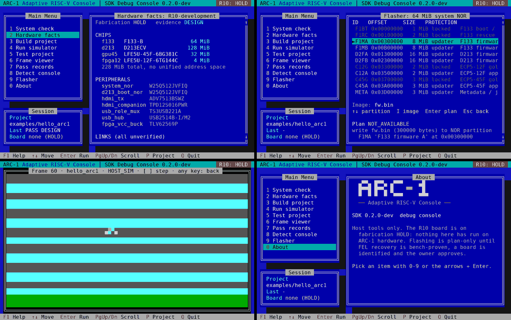

# ARC-1 Workbench R10 — Classic main screen

**Install:** extract the ZIP and double-click `INSTALL_ARC1.cmd`. It sets up Python, Qt and a compiler if needed,
adds Start menu and desktop shortcuts, and can be removed from Settings › Apps. Without installing:
`START_ARC1_QT.cmd` (needs PySide6) or `python -m workbench.qt_app`.
Workbench now looks and behaves like a familiar Windows file manager and editor:
- **Default screen:** menus, one toolbar (Open, Save, Build ▾, Run, Tests, Target), a project navigator, your
  documents and a status bar.
- **Shown only when needed:** Output, Problems, the hardware inspector and the cartridge shelf.
- **Everyday keys:** F7 builds whatever you're working on, F8 jumps to the next compiler error, F5 runs the
  game in the host simulator, and Ctrl+P finds a file.
- **Remembered between sessions:** your documents and layout. View › Reset Window Layout gets the
  factory layout back.

Guide: [docs/WORKBENCH_R10.md](docs/WORKBENCH_R10.md) · Notes: [PATCH_NOTES_R10.md](PATCH_NOTES_R10.md).
R10 was tested with Qt on Linux (offscreen); Windows 11 qualification is R14. The Tk desktop (`START_ARC1.cmd`)
is still available.

<p align="center"></p>

---

# ARC-1 Workbench R09 — Compact Output Panel

**Pass focus:** reclaim editor area. The lower console can now be hidden with **F10**. Compile/test actions show build output when needed; see [R09 output guide](docs/R09_OUTPUT_PANEL.md). The source-backed R09 Qt UI still requires PySide6 and Windows testing. The tested fallback is launched with `START_ARC1.cmd`.

# ARC-1 Workbench R08 — Experimental Qt 6 Edition

**New human desktop:** `START_ARC1_QT.cmd` on Windows 11 with PySide6. See `docs/QT_R08_INTERFACE.md`. The Qt shell is authored but not yet runtime-qualified in this environment; install PySide6 separately. The existing, tested Tk desktop remains at `START_ARC1.cmd`, now with more restrained professional graphite/orange controls. Both share SDK, firmware, cartridge, host launcher and AI-agent implementations. There is no physical deployment/flash support and the linker-stage images remain non-bootable.

---

# ARC-1 Workbench R07 — Host Game Launcher and Workspaces

**Start on Windows 11:** extract this ZIP, open `START_ARC1.cmd`, then select **Cartridge > Game launcher** or press **F6**. Requires Python 3.11+ with Tkinter and a suitable C11 compiler for Windows host build. If the game has not been built on this computer, choose **Build > Build game**, then return to the launcher. A Linux-compiled executable bundled with the development archive does not run on Windows. Windows qualification remains pending.

**New in R07:** Verified host game shelf; run/stop local C11 sample game; preview frames generated by the real host simulator; Code/Cartridge/Debug persistent workspace presets under View; Ctrl+P Quick Open; Ctrl+Shift+P Command Palette; matching agent methods in [docs/AGENT_INTERFACE_R07.md](docs/AGENT_INTERFACE_R07.md). See [Pass 7 notes](PATCH_NOTES_R07.md) and [product plan](docs/roadmap/ARC1_WORKBENCH_PRODUCT_SPEC_R07_R12_REV_A.docx).

**Important:** This is an executable **host simulation**, not a physical ARC-1 game loader. The cartridge remains an asset archive, not an executable. The actual F133/D213 firmware link tests are NOT BOOTABLE and physical flashing is unavailable.

**CURRENT: ARC-1 Workbench R05 (Pass 3).** Orange Aqua-style human UI plus structured agent UI. See [Pass 3 release notes](PATCH_NOTES_R05.md), [boot/LCD implementation](docs/BOOT_LCD_PASS3_R05.md) and [agent protocol](docs/AGENT_INTERFACE_R04.md). See [R04 release notes](PATCH_NOTES_R04.md), [human UI guide](docs/WORKBENCH_HUMAN_INTERFACE_R04.md), and [agent API](docs/AGENT_INTERFACE_R04.md). This is a development preview, not production firmware.

**Workstation:** ARC-1 Workbench desktop application (preview). Start with `START_ARC1.cmd` on Windows 11 or `python -m workbench.app` or `python arc1 workbench` in a desktop session. See [workbench/README.md](workbench/README.md). Hardware flash writes are not available.

**Unified firmware workflow:** `python arc1 firmware status`, `python arc1 firmware build --target status-lcd`, `python arc1 firmware test`. On Windows use `arc1.cmd` or `START_ARC1.cmd`. Read [firmware/DEVELOPMENT_WORKFLOW.md](firmware/DEVELOPMENT_WORKFLOW.md) for status and limitations.

<p align="center"></p>

# ARC-1 SDK + Firmware Workbench — R02 (Development Preview)

This is the first vertical slice of the agent-native SDK described in
*ARC1-SDK-ER-002 Engineering Requirements v0.2*. It contains:

- a portable `arc1` CLI
- a C11 game API
- a deterministic host simulator
- the `hello_arc1` demo, with golden-frame and replay tests
- JSON Schemas and validators for pass records, hardware manifests and game
  packages, each with negative fixtures

A first shared branding contract is in `branding/identity.json`. Run `python arc1 brand`
for verified original artwork hashes and LCD reference texts. `firmware/` now also contains an editable, compileable F133 LCD status service and preserved R10 firmware sources. This **does not** constitute board-ready boot firmware. See [branding/firmware plan](docs/BRANDING_FIRMWARE_INTEGRATION.md).

**What this is not:** it is not evidence that any ARC-1 hardware works. There
is no board or linked target boot firmware here. Optional RISC-V object compilation is supported if a suitable Clang is installed. Results
are labelled `HOST_SIM` or lower, and device commands answer `NOT_AVAILABLE`.

Coding agents: read [AGENTS.md](AGENTS.md).

## Hardware facts

`./arc1 hw inspect` reports the board as the R10 engineering handoff describes
it: F133-B, D213ECV, LFE5U-45F and LFE5U-12F with four separate memory pools,
a 64 MiB central NOR, an ADV7513 HDMI transmitter with F133 I2S audio, and a
USB2514B hub for two controller ports and the top cartridge port. Every fact
cites an unmodified R10 file in `hardware/sources/r10/` by SHA-256, and the
tool fails if a cited file changes. The board is on **fabrication HOLD**:
schematic and first placement only, not routed, not built, nothing measured.

## Debug console

`./arc1 ui` opens an 80×25 DOS-style menu over everything the SDK does: system
check, hardware facts, build, simulator, tests, a frame viewer, pass records,
console detection on the rear USB-C port, and a NOR flasher.

<p align="center"></p>

Keys: `0`–`9` or the arrows and Enter run an item, PgUp/PgDn scroll, `P`
changes the project, `F1` shows help and `Q` quits. In the frame viewer, `[`
and `]` step 10 frames. In the flasher, the arrows pick a partition, `I` sets the
image and Enter builds the plan.

The flasher builds and checks a complete write plan: target partition, fit,
SHA-256 and the exact `xfel` commands. It **does not write**, because no board
exists, FEL recovery is not bench-proven and nobody has approved a write. Detect
only runs the read-only `xfel version`, and only if `xfel` is installed. The UI needs a
terminal of at least 80×25. On Windows use WSL, or `pip install windows-curses`.

## Prerequisites

- Python 3.9 or newer, standard library only. Nothing is installed with pip.
- A C11 compiler on `PATH` as `cc`, `gcc` or `clang`. Tested versions are
  listed in `tools/lock/toolchain.lock.json`.
- git (optional). It enables the base-commit and protected-file checks in
  `arc1 pass validate`.

Linux and macOS are the targets. On Windows, run the CLI as `python arc1 …`
from a shell where a C compiler is on `PATH`. That setup has not been tested.

## Clean build (copy and paste)

```sh
git clone https://github.com/c8wf7gt28n-prog/Struthio.git && cd Struthio/arc1
./arc1 doctor
./arc1 build examples/hello_arc1
./arc1 sim examples/hello_arc1 --replay tests/replays/steer.replay --dump 0,60,119
./arc1 test examples/hello_arc1
./arc1 pass validate passes/ARC1-PASS-0001
./arc1 pass validate passes/ARC1-PASS-0002
./arc1 ui
python3 tests/run_tests.py
```

Each command exits 0 on success, except `./arc1 ui`, which is interactive (Q quits). `sim` writes PPM frames to
`examples/hello_arc1/build/sim/`. `doctor` warns that no physical board
exists, which is expected.

## Make a game

```sh
./arc1 new mygame --dir /tmp
./arc1 build /tmp/mygame && ./arc1 test /tmp/mygame
```

Edit `src/main.c`, then rebuild. `test` fails with the first divergent frame
until you record new goldens with `./arc1 test /tmp/mygame --update-golden`.
Re-recording a golden is a review-sensitive change.

## Reference

- [docs/API.md](docs/API.md): the `arc1/game.h` contract.
- [docs/CLI.md](docs/CLI.md): commands, exit codes and the result format.
- [docs/TRACEABILITY.md](docs/TRACEABILITY.md): requirement status.
- [docs/MIGRATION.md](docs/MIGRATION.md): schema changes between versions.
- [hardware/sources/r10/PROVENANCE.md](hardware/sources/r10/PROVENANCE.md):
  where the hardware facts come from.
- [passes/ARC1-PASS-0004/HANDOFF.md](passes/ARC1-PASS-0004/HANDOFF.md): the
  latest handoff.

## R04 — classic desktop UI, agent API, and two CPU link-stage builds

**Human UI:** double-click `START_ARC1.cmd` on Windows 11 with Python 3.11+ installed, or run `python -m workbench.app`. Uses classic File Manager directory tree, details list and Word 6-style menu/editor. Windows-native runtime qualification remains pending.

**Agent UI:** `python arc1 agent` (JSON-lines over stdin/stdout); see `docs/AGENT_INTERFACE_R04.md`. Optional `--allow-writes` grants bounded SHA-256 guarded source edits. Does not require the human GUI to be open. The app contains no hardware write support.

**Target firmware link tests:** install LLVM Clang, LLD and `llvm-objcopy`, then run `python arc1 firmware image --target all`. Produces per-chip `.elf`, `.bin`, `.map` and SHA-256 manifest in `firmware/build/stage/`. These are **NOT BOOTABLE**. The F133 stage includes the portable LCD status service, but no I2C hardware driver. See `firmware/stage/README.md`.

**R04 actual screenshot:** `docs/assets/workbench_r04_actual.png` is captured from the running Tkinter application under a Linux X virtual framebuffer. A Windows 11 machine has not been used to test it.

**Known engineering holds:** unqualified startup/boot ROM and memory maps, missing F133/D213 BSP and HAL, actual DDR bring-up, real graphics/USB drivers and physical board testing. R10 PCB still on FABRICATION HOLD. See `PATCH_NOTES_R04.md`.

## R06 Pass 4 — compact orange Aqua + drag workflows + host cartridges

**Current R06 engineering preview.** The orange Aqua title strip is 51 px instead of the previous 93 px, with compact action and directory rows. F9 toggles the diagnostics pane to maximize editing space. Finder-like within-project drag copies files into a directory only after confirmation. See `PATCH_NOTES_R06.md` and `docs/R06_CARTRIDGE_WORKBENCH.md`.

`python arc1 cartridge package`, `cartridge inspect`, and `cartridge stream` provide host archive verification and a deterministic transfer-latency model. The archive has no ARC-1 native executable and the simulation is not a USB hardware test. The agent interface offers equivalent tightly-scoped methods; physical flash writes remain unavailable.

**Installation:** On Windows 11, extract the ZIP and drag its `arc1` folder wherever you want, then double-click `START_ARC1.cmd`. Alternatively start `INSTALL_ARC1.cmd` for an optional per-user installer with a drag-the-app-to-My-Apps metaphor and Start Menu shortcut; no administrator rights required. The installer has not been run on an actual Windows 11 host. External Explorer `.arc1cart` drop handling requires optional `tkinterdnd2`; use Cartridge > Import without it. See `INSTALL_README.txt`.
