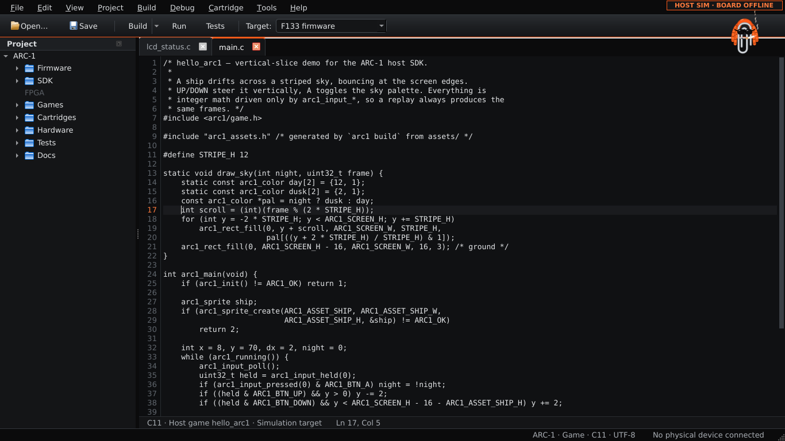
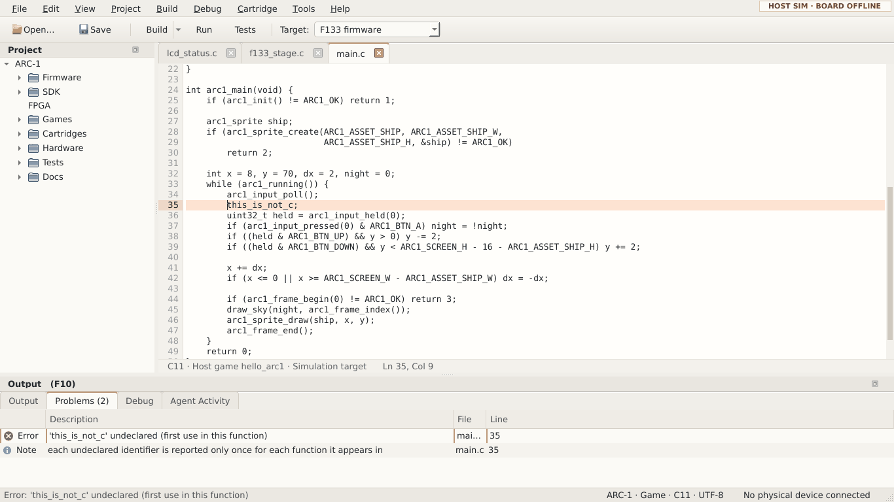
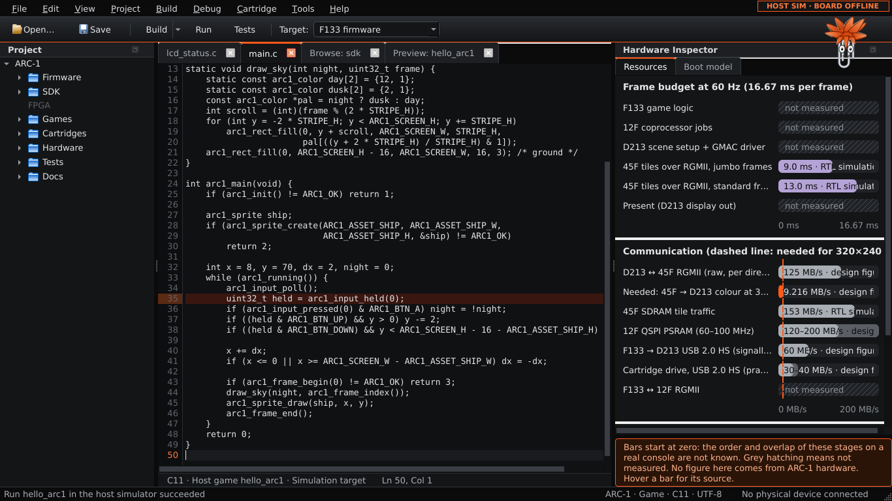
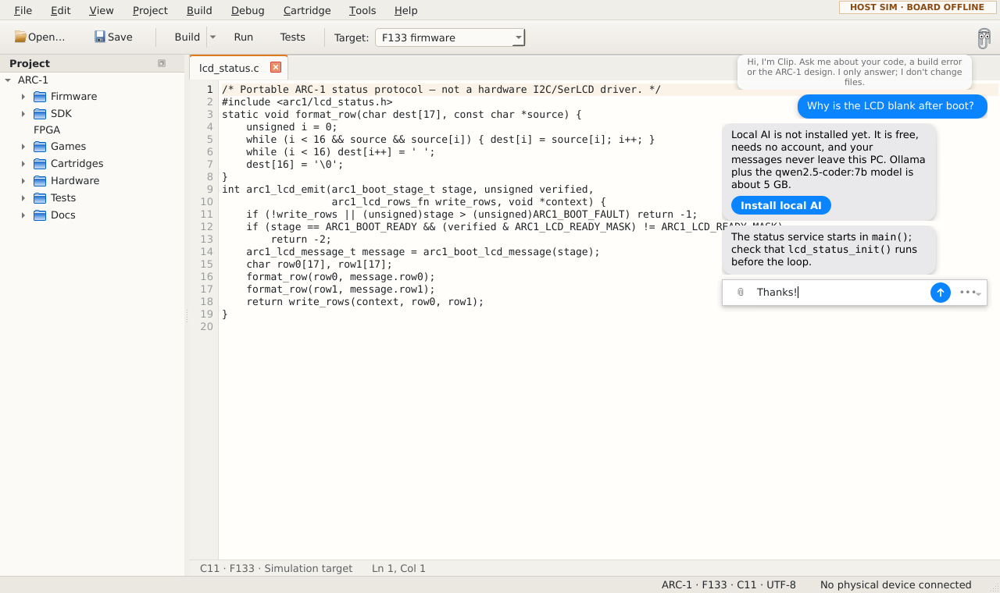

# ARC-1 Workbench R10 — Classic main screen

**Design rule (owner decision, R10):** Workbench behaves like the File
Manager and document editor you already know, and shows the console
engineering tools when a task needs them.

**Install:** extract the ZIP and double-click **`INSTALL_ARC1.cmd`** (see
[Installing](#installing)). To run without installing, use
`START_ARC1_QT.cmd` (needs PySide6) or `START_ARC1.cmd` (classic Tk window).



## What is on the screen

- **Title bar:** the standard Windows title bar with minimize, maximize and
  close. Workbench does not draw its own.
- **Menus:** File, Edit, View, Project, Build, Debug, Cartridge, Tools, Help.
  The badge at the right of the menu bar always reads **HOST SIM · BOARD
  OFFLINE**.
- **One toolbar:** Open, Save, Build ▾, Run, Tests and **Target**. The Build ▾
  arrow holds *Build All Firmware Stages* and the target list.
- **Project navigator** (left, about 236 px): ARC-1 › Firmware, SDK, FPGA,
  Games, Cartridges, Hardware, Tests and Docs.
  - FPGA is greyed out: this project holds no FPGA sources (the R10 RTL is in
    the hardware handoff), and the navigator doesn't pretend otherwise.
  - Clicking a folder opens it in the Browse tab.
  - Double-clicking a file opens it.
- **Documents:** one tab per file, with line numbers and a highlighted current
  line.
  - The strip under the editor shows language, target and position, e.g.
    `C11 · F133 · Simulation target   Ln 17, Col 5`.
- **Status bar:** `ARC-1 · F133 · C11 · UTF-8` on the left and **No physical
  device connected** on the right.

These start hidden and appear when the work needs them:

- **Output panel** (F10), with tabs for Output, Problems, Debug and Agent
  Activity. It opens by itself when a build fails, on the Problems tab. A
  successful build only reports in the status bar.
- **Hardware Inspector** (host boot-diagnostic model) and the **Cartridge
  Shelf**, both in the View menu.
  - On a monitor 1900 px or wider, the Inspector opens by itself the first
    time.

## How the screen follows your work

| Activity | Main area | What appears |
|---|---|---|
| Open Workbench with no documents | **Start** tab: open, find a file, browse, new game, recent files | Navigator only |
| Edit firmware or game code | Source editor | Navigator |
| Browse files | **Browse** tab: Name, Size, Type, Date Modified. Optional dual pane (View) | Navigator |
| Build or test | The editor stays in front | Output on failure (Problems tab); status bar on success |
| Run a game | **Preview** tab with the simulator's frames and a frame slider, labelled HOST SIMULATION | Debug tab gets the run summary |
| Inspect hardware status | Hardware Inspector (View), host model only | — |
| Prepare a cartridge | Cartridge menu and Cartridge Shelf | Output shows the inspection |

Saved Code, Cartridge and Debug layouts for each activity are part of R12,
not this pass.

## The everyday workflow

1. **Find a file:** use the navigator, or press **Ctrl+P** and type part of the
   name (`main.c`).
2. **Open, edit, save:** Ctrl+O and Ctrl+S, plus Ctrl+Shift+S to save all.
   Ctrl+Z / Ctrl+Y, Ctrl+F / F3, Ctrl+H and Ctrl+G work as in any Windows
   editor.
3. **Build** with **F7** (or Ctrl+Shift+B). Build picks the target for the
   file in front of you:
   - A file inside a game project (`examples/<game>/…`) builds that game.
   - Any other file builds the selected Target: F133 firmware, D213 firmware,
     the F133 LCD status service or Host game.
4. **Read the compiler error:** a failed build opens Problems with Error,
   Description, File and Line.
5. **Go back to the source line:** double-click the problem, or press **F8**
   (Shift+F8 for the previous one). The line is marked in the editor and the
   gutter.
6. **Run the simulator** with **F5**. It rebuilds the game, runs 120 frames on
   this PC and shows them in the Preview tab.



## What Workbench remembers

It remembers the documents you had open (with cursor positions), the active
tab, the target, the recent files, whether the output panel was open, the
panel sizes and the window layout. The next start puts you back where you
were.

To get a clean screen back, use **View › Reset Window Layout**. It restores
the factory layout and keeps your documents open.

The memory lives in one small JSON file:
- Windows: `%APPDATA%\ARC-1\Workbench\session-r10.json`
- Linux: `~/.config/arc1-workbench/`

Every value is checked when it is loaded. A layout saved by a different
layout version is ignored rather than applied wrongly.

## File operations (Browse tab)

New File, New Folder, Rename (F2), Duplicate (makes `name - Copy.c`, as
Explorer does) and Delete (Del, with confirmation, files only). Windows naming
rules apply on every platform, so a project stays portable:
- no `< > : " / \ | ? *`
- no `CON`, `NUL`, `COM1` and the like
- no trailing dot or space
- a name that differs only in upper/lower case counts as the same name

Nothing is ever overwritten. Recorded evidence (`passes/` and
`hardware/sources/`) opens read-only and cannot be renamed or deleted from
Workbench.

## One engine for people and agents

```
Qt window ─┐
CLI ───────┼──►  workbench/engine.py  ──►  arc1 CLI commands  ──►  host compiler / simulator
agent ─────┘     (targets, plans,           (validated, timeouts,
                  problem paths)             scrubbed environment)
```

The Qt window and `python arc1 agent` take their build, test and run commands
from the same table in `workbench/engine.py`. Changing the screen therefore
cannot change what automation does. Agents never drive the GUI.

## Resource budgets (View › Resource Budgets)

The Hardware Inspector's **Resources** page draws three bar charts on fixed
scales:
- **Frame budget:** the 16.67 ms of a 60 Hz frame.
- **Communication:** MB/s per link, with a dashed line at the 9.216 MB/s
  that 320×240 at 60 fps needs.
- **Memory:** the four separate pools, 228 MiB in total.



Every number comes from `hardware/budgets/r10_resources.json` and quotes the
exact sentence in a vendored R10 document that states it. Hover a bar to see
the quote and its evidence class (design figure or RTL simulation).

If the quoted sentence is not found in the source, the number is dropped
and the bar says **CITATION MISSING**. Nothing has been measured on F133
game logic, the D213 driver, 12F jobs or display output, so those bars are
hatched **not measured**.

All bars start at zero. How the stages overlap on a real console is not
known yet, so the chart does not pretend to show a schedule.

Agents read the same data with the `inspect.resources` method of
`python arc1 agent`.

## Clip (chat bubbles)

Click the paperclip at the right end of the toolbar. Clip's chat appears as
speech bubbles floating over the Workbench window, just under the paperclip:
yours in blue on the right, replies in grey on the left. There is no
separate window.
- **Showing and hiding:** click Clip again, or press **Esc** in the message
  field, to hide the bubbles. A reply that arrives while they are hidden
  pops them back up.
- **The editor stays usable:** only the bubbles and the message field catch
  the mouse, so you can keep clicking in the editor around them.



**Where Clip gets answers** (••• › Settings):

| Choice | Account or key | Leaves this PC? |
|---|---|---|
| **Local AI** (default), using Ollama with `qwen2.5-coder:7b` | none, free | no |
| **Google Gemini** | free key from aistudio.google.com/apikey | yes |
| **OpenAI API** | paid API key | yes |
| **ChatGPT website, copy & paste** | your ChatGPT login | yes, and you paste in the browser |

**First use of Local AI:**
1. Clip shows an **Install local AI** button. It installs Ollama with
   winget; Windows may ask for permission.
2. Clip downloads the model, about 5 GB once, showing progress in a bubble.
3. Clip then answers the message you already sent.

**Limits of Local AI:**
- It needs about 8 GB of memory.
- On smaller PCs, set the model to `qwen2.5-coder:3b`.
- Its answers are weaker than ChatGPT's.

**What is sent:** the 📎 toggle sends the open file with your message. It
is off by default. Clip only answers: it changes no files and runs nothing.
It never drives a browser window. That would break whenever the site changes
and is against OpenAI's terms.

## Installing

Double-click **`INSTALL_ARC1.cmd`** in the extracted folder. Press Enter to
accept each suggested answer. No administrator rights are needed, except for
the optional LLVM step, where Windows asks for permission.

1. **Python:** finds Python 3.11+, or offers to install Python 3.12 for your
   account with winget.
2. **Copy:** copies Workbench to `%LOCALAPPDATA%\Programs\ARC-1 Workbench\app`.
3. **Qt:** installs Qt (PySide6 6.8.1) into a private Python environment
   (`runtime\venv`). Nothing else on your PC changes.
4. **Compiler:** finds a C compiler. If there is none, it offers to install
   LLVM (clang) with winget.
5. **Shortcuts:** creates Start menu and desktop shortcuts with the ARC-1
   icon, plus an entry in **Settings › Apps › Installed apps** for
   uninstalling.
6. **Check:** runs `arc1 doctor`, then offers to start Workbench.

**Upgrading:** run the new version's installer. Any file you changed or
added inside the installed Workbench is first backed up to
`Documents\ARC-1 Workbench backups\<date> (before upgrade to …)`. The
private Python environment is reused, so upgrades are quick.

**Uninstalling:** use Installed apps, or `Uninstall ARC-1 Workbench.cmd` in
the install folder. Changed files are backed up the same way first. Your
settings (window layout and recent files) stay in `%APPDATA%\ARC-1`.

The shortcut starts the Qt window. If Qt is missing, it starts the classic
Tk window instead. If something fails, a message box explains it and the
details go to `launch-error.log`.

## Known limits of R10

- **Windows and display scaling:** Workbench and its installer have not run
  on Windows 11 yet (R14). The installer's Windows-only steps (shortcuts,
  Installed apps entry, winget, the uninstall `.cmd`) were checked with
  stand-ins, not on Windows. It was tested with Qt 6.8.1 on Linux with the offscreen platform.
  Display scaling and keyboard and accessibility qualification are not done.
- **Editor:** one document per tab, with no split view, project-wide search
  or crash recovery. That is R11.
- **Agent Activity:** it does not stream agent requests yet. It says so
  rather than showing invented activity.
- **No device features:** there is no device, no debugger connection and no
  flashing. Debug › Run uses the host simulator.
