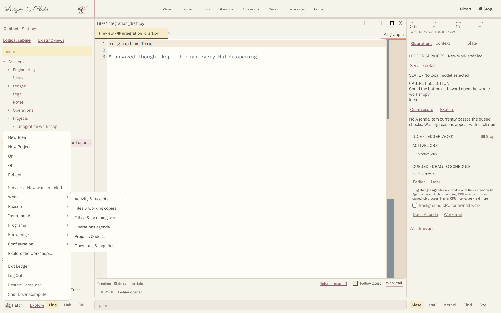
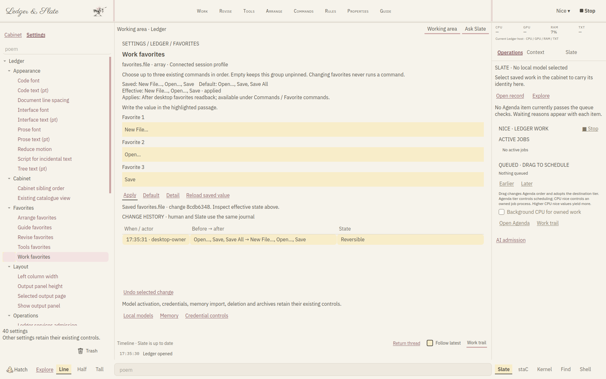
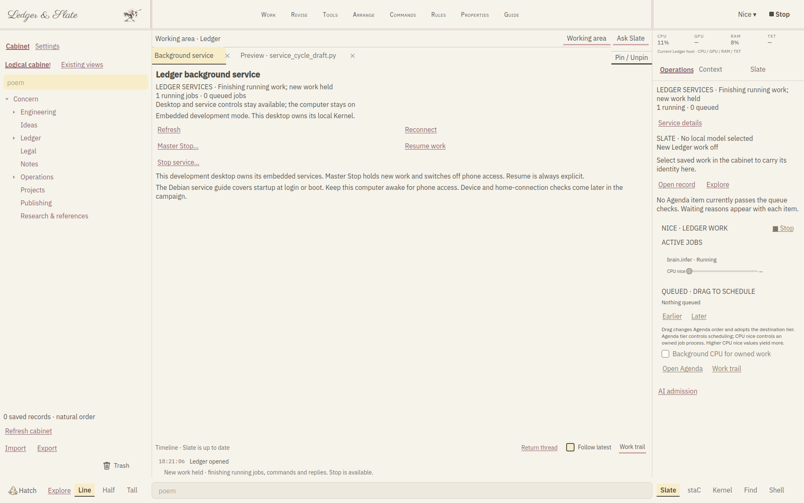
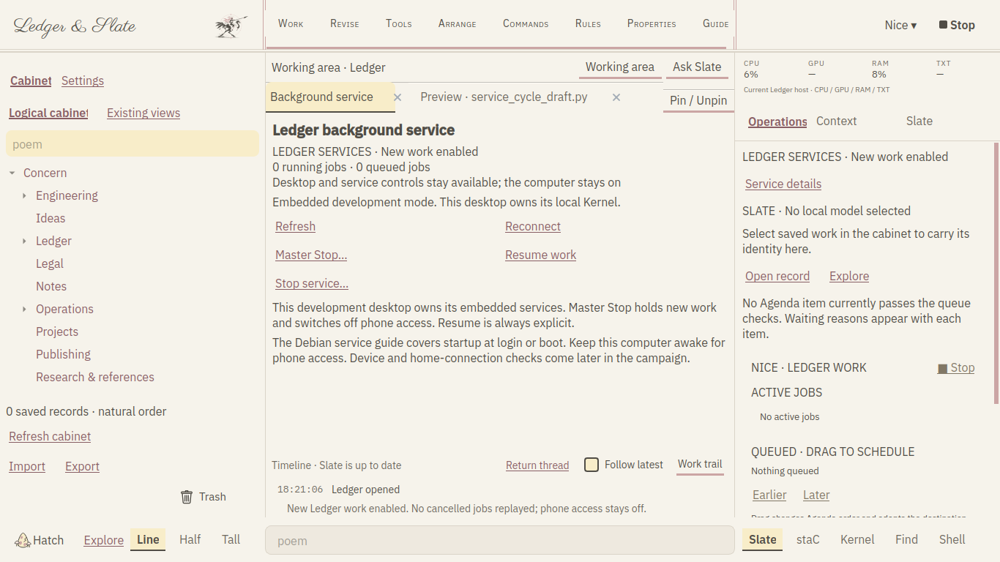

# Ledger and Slate Complete Project Specification

Version 1.2 (WORKSHOP-01 revision of the 1.0 text). November 5, 2026. America/Phoenix. Product owner Ryan Peddycoart. THE STRUTHIO CONCERN.

Ledger & Slate is a personal workshop for developing ideas into useful, inspectable work. Ledger holds the records, instruments, execution rules and evidence. Slate is the resident assistant that helps the owner understand, improve and carry out that work. staC connects written intentions to the same checked operations that the interface uses. The intended finished system runs as the main visible workspace on a minimal Debian computer, with local reasoning, durable files and a clear route back to the underlying system.

This specification describes the complete product we want to build, the way it should behave and the conditions required before we call it complete. It also identifies what the current INTEGRATION-01 checkpoint demonstrates and what remains a goal or an acceptance task. It is a product and engineering reference for future development, implementation review, installation and owner testing. A planned feature in these pages does not become a completed capability merely because it has been described.

## 1 Product purpose

The owner should be able to put an unfinished idea into Ledger without first deciding which application, file format or technical discipline it belongs to. A short thought can remain a note, become part of a project, turn into an inquiry, acquire sources and calculations, and eventually produce a document, program, design or other result. The record should survive those transitions with an understandable identity and history.

The system should help make an idea more real. That means identifying what is known, what is assumed, what is missing and what action would answer the next useful question. Slate should be able to explain the current work, propose alternatives, use appropriate tools and retain the results. The owner should be able to inspect the same materials directly, make changes and continue without depending on a conversation transcript as the only record of the work.

A complete LS experience combines a manageable daily interface with serious underlying capabilities. Starting a note should be simple. Inspecting the exact source, command, dependency, result or permission behind a complex investigation should remain possible. Simplifying the presentation must preserve useful engineering functions rather than burying or removing them.

The project belongs to the wider Struthio Concern, but the immediate software product is Ledger & Slate running on Linux. ARC hardware projects, games and documents are work that LS can help develop. Their physical readiness, commercial release and source acceptance have their own requirements. Progress on the desktop does not qualify a board or establish that an external tool has produced a correct design.

## 2 Meaning of current and complete

A product requirement states how the finished system must behave. An implementation statement describes code or a visible route present in the current checkpoint. A verification statement names the test or observation that supports a claim. Owner-host acceptance means the relevant behavior has been exercised on the actual target computer with the appropriate inputs. These categories must stay distinguishable in specifications, interface wording and progress reports.

The INTEGRATION-01 checkpoint carries the previous complete source and evidence and adds the Hatch capability launcher with its session footer, the connected hardware category-view setting, service-cycle, Operations and installer readback repairs and a release check that follows the HATCH checkpoint. Its shared registry contains 690 operation schemas and 112 job-tool targets. Forty-one genuine settings are connected to the shared Settings tree. The Explore catalogue and the 21 Hatch workspace adapters are discovery projections; their counts are not counts of independently installed programs or qualified native engines.

Current strict HATCH acceptance remains zero of six. Historical integrated acceptance remains four of six. Exact-model/native I05 and owner-host I06 remain open. These figures describe their own acceptance sets and must not be merged into a percentage for the entire product. The four-pass cloud estimate after NAVIGATION-01 was a development planning aid. Completing its fourth pass does not mean that the complete product is accepted; the acceptance table in section 30 is the measure, and owner-host work remains.

A capability can be registered while its executable is missing, its runtime is unqualified, its input is unsuitable or its required grant is absent. The finished interface must make that useful distinction visible. It should help the owner repair the relevant prerequisite, keep inspection available where possible and avoid describing an unavailable action as if it has already run.

## 3 Roles and responsibilities

The owner sets goals, controls original material, chooses the scope of work and decides when a result is accepted. Ordinary requests within an already authorized working scope should proceed without repetitive permission questions. Changes that cross an established boundary, such as replacing an original outside a working copy or granting a new execution scope, must retain their meaningful review step.

Ledger owns durable state and authorized execution. It supplies the filing cabinet, project records, instruments, settings definitions, jobs, candidates, receipts, recovery and evidence. It should be useful when no model is installed or Slate is switched off. Reading, editing and organizing work must not be held hostage by an inference service.

Slate supplies collaboration: conversation, explanation, suggestions, retrieval, structured proposals and bounded tool use. Slate must read relevant structured state when it exists. It should not infer authoritative settings, process health or record ownership from a picture of the interface. It must recognize the difference between a useful suggestion and a completed, accepted result.

staC is the retained automation language, pronounced Stacy. It gives the human and models a shared typed route into Ledger operations. The visual menus should remain another way to prepare those same commands. staC must not become a second unrestricted execution system that bypasses the Kernel, working-copy rules or evidence requirements.

External tools retain their own interfaces, dependencies and limitations. A supported Calc, Writer, CAD, debugger or other application view can be part of an LS workflow when its supported exchange is defined. Installing a tool does not automatically prove that its outputs can be imported, edited or round-tripped faithfully.

## 4 Architecture of the finished system

The base operating system is Debian. Linux continues to provide the kernel, drivers, storage, networking, accounts, package management and process supervision. LS is the owner's visible workshop on that system. We are not replacing Linux with a newly invented operating system or requiring a second computer to make the primary product useful.

Above Debian, the intended dedicated session uses a small display stack and Fluxbox window management with Ledger's Qt interface in the foreground. The normal daily experience should present LS directly. The owner should not have to navigate a GNOME or KDE desktop to reach the work. Native dialogs and supported external applications still need sensible window management and a reliable return path.

The shared Engineering Kernel sits beneath the interface and command clients. It owns registered operations, scopes, durable jobs, candidates, resource limits, execution grants and receipts. The GUI, local assistant, CLI and approved remote clients should converge on this shared behavior. A display widget may collect input and show progress, but it must not secretly gain broader execution authority than an equivalent typed command.

The coordinator can remain available as a local control process while worker services are stopped. That allows service inspection, reconnection and explicit On to remain reachable. Local model workers, native jobs, console processes, language services and remote listeners have their own lifecycles. The product must explain which of these is running rather than treating one process flag as the state of the whole computer.

Persistent knowledge and user work live outside replaceable model weights. Sources, indexes, accepted facts, projects, memory profiles, settings and recipes must remain useful when the owner changes models. Rebuilt indexes and model summaries are derived material. Manufacturer originals, unique evidence and owner writing require preservation appropriate to their importance.

## 5 Target machine and operating environment

The primary owner target is the Debian 13 ThinkPad with an AMD Ryzen processor, 64 GB of RAM, solid-state storage and Radeon integrated graphics. CPU inference is the dependable baseline for qualification. Optional Vulkan acceleration can be added when the exact runtime, driver and model combination has been tested. The product must not depend on CUDA hardware that the target does not have.

The system should remain practical in a text-based Debian environment until the owner launches the graphical session. A dedicated appliance installation may later start LS automatically after an agreed login or boot step. Automatic login, storage encryption, account recovery, wireless setup and physical console access require deliberate deployment decisions. The current installer does not silently replace those operating-system policies.

Local work should remain available without an internet connection once the required software, sources and model assets are installed. Optional cloud assistance, public downloads and remote access are distinct network-dependent activities. The interface should explain when a request requires one of those activities and what information would leave the machine.

The iPhone is a useful place for short updates, review and a permitted remote view. It does not change where the authoritative local work lives. A future remote experience should feel close to the same workshop, preserve authentication and command ownership, and avoid mandatory dependence on a third-party routing service as a permanent architectural requirement.

## 6 Startup and return to Debian

The intended manual startup route is a Debian text login followed by one LS command. START_MINIMAL_DEBIAN.sh checks for the required session tools and starts a dedicated X session when no graphical display is active. LS_XSESSION.sh starts Fluxbox without its toolbar or slit, opens Ledger fullscreen and ends that session when Ledger exits. From an existing display, the entry point opens the fullscreen Office instead of starting a competing X server.

The dedicated session needs an X server, xinit/startx, Fluxbox, a session bus and the Qt runtime, along with the actual machine's display and input support. The minimal-session dependency option names these prerequisites. A working wireless connection is needed before a network installation can fetch its remaining packages. Missing firmware must be supplied through the Debian installation or a matching offline bundle; LS cannot download over hardware that Debian has not yet made usable.

A normal exit from the dedicated graphical session returns to the Debian text environment. This is separate from switching off LS worker services. Hatch Off keeps the desktop open so the owner can continue reading, writing and inspecting. Since INTEGRATION-01 the Hatch session footer provides the visible exit command: it reads Return to Debian inside the dedicated session, which exports a session marker, and Exit Ledger from an existing desktop, where no session of Ledger's own ends. It opens the existing leave review and the ordinary save prompts, stops the local model and tracked commands and closes Ledger; the computer stays on, and the entry script then reports Ledger's exit status. Log Out, Restart Computer and Shut Down Computer are shown unavailable because Ledger issues no session or power command; the console is the route after Return to Debian.

A complete appliance edition will need a tested choice between manual launch, launch after an owner login and a supervised boot-to-workshop path. It must also provide an understandable recovery path when Qt, a driver or a model fails. The owner must be able to reach a text console and inspect or repair the installation. The current launch scripts provide the manual session foundation; automatic appliance startup remains an owner-host deployment task.

## 7 The visible desktop

The desktop is organized around three working areas. The left column is a filing cabinet and the alternate Settings hierarchy. The center is the active work, including focused instruments, documents and source previews. The right column shows operations, context and Slate. These areas must retain clear responsibilities as more capabilities are added.

The left panel should feel like an office filing system rather than a dump of operating-system paths. The center should give the work enough space to develop. The right should make ongoing activity understandable without turning every progress message into a new modal dialog. Resizing a column or opening an instrument should preserve the identity of the selected work and any unfinished writing.

Current top-level words are Work, Revise, Tools, Arrange, Commands, Rules, Properties and Guide. Their labels can be reviewed without changing operation identities or familiar keyboard behavior. Save, Undo, Copy, Find and other ordinary actions should remain recognizable inside the menus. Distinctive language should help orientation rather than make basic work needlessly cryptic.

The lower typing area offers the existing Slate, staC, Kernel, Find and Shell destinations and the Line, Half and Tall console sizes. Hatch remains at the lower left. The owner should be able to understand where an instruction will go before sending it. The shell destination must keep its declared working scope; it is not an implied permission to modify every file on the machine.

## 8 Functional colors and writing

Graphite shades carry ordinary reading, structure and explanation. Highlight yellow identifies writable passages and material that needs attention. Eraser pink identifies actions and other clickable controls. These roles should remain consistent across Ledger-owned surfaces, with labels, position and keyboard focus reinforcing meaning rather than relying on color alone.

The goal is writing directly into the work. A note, an idea, a setting or a small instruction should look like a highlighted passage rather than a stack of conventional form boxes. The underlying editing behavior still needs precise insertion, selection, copy and paste, undo, focus and accessibility. Removing a border must not remove the behavior that makes text editing reliable.

Empty text hints use the exact lowercase word poem. The accessible label and nearby explanation still describe what belongs in the passage. The placeholder is a visual language decision; it must not become the only explanation of a command field, a project title or a settings value.

Cursive belongs in the Ledger & Slate wordmark and restrained incidental writing. Working text, code, settings explanations and dense technical information need readable fonts. Reading size, font choices and reduced motion are genuine preferences. The proposed blinking X should be evaluated as a writing marker while preserving a precise editing caret; it is an open interface experiment, not a completed replacement throughout Qt.

The preferred identity is the Struthio mark with the Ledger & Slate writing. Earlier fairy or Stacy character concepts do not define the current desktop. A character should not occupy working space or distract from the task merely because an older plan mentioned one. The current paper interface and owner review should govern future identity changes.

## 9 The filing cabinet

The cabinet organizes the owner's concerns, offices, projects, folders and records. It should support an office-like structure without forcing every record through four empty levels. A small project can remain simple. A larger one can contain sources, ideas, inquiries, calculations, drawings, code, results and decisions in a structure that the owner can understand.

Each record needs a stable identity independent of the label shown in a tree. A second useful placement should normally be a reference to that identity rather than a competing copy with an uncertain owner. Opening a reference should resolve the same underlying work. Renaming or filing a record should not silently change a linked source, evidence claim or acceptance state.

Sibling ordering should follow an explicit, consistent policy. The current natural ordering is case-insensitive and keeps numbered names such as Project 2 before Project 10. The existing alphabetical alternative compares labels as text. Sorting changes presentation, not record parentage. User-defined ordering, if later introduced, needs its own clear scope and migration behavior.

The cabinet should distinguish logical records, their placements, references, alternate views and settings nodes. These are different roles. Adding a tool or an external application should not create another top-level filing root automatically. Physical paths can be inspected in details, while the primary hierarchy remains organized around the work.

Search and filtered views must preserve identity. A temporary query must not permanently overwrite the saved expansion of the ordinary tree. Returning to a view should restore an understandable selection and scroll position. The selected item must remain visible when the window or font size changes, while a deliberate collapsed branch should not be reopened continually against the owner's choice.

## 10 Trash and external transfers

Trash stays fixed at the bottom-right of the left Navigator panel. It is outside the scrollable tree. Its meaning must not change when the cabinet is filtered, when Settings is shown or when the tree gains more records. Deleting and restoring should identify the actual target and retain the established record and owner boundaries.

Import and Export describe transfer direction and remain outside ordinary filing. A USB device may support either direction, but its role for a particular transfer must be explicit. The owner should not need to browse a second raw device tree as the main experience. The existing pill and working-copy rules should explain what is being received, reviewed, returned or exported.

A received file is not automatically an accepted source. Imported material can be retained in quarantine or a review area, then admitted through the appropriate route. The original file, its provenance and its reviewed working version should remain distinguishable. A transfer should not imply continuous synchronization or authority to overwrite a master elsewhere.

The long-term product may use USB, local networking and approved remote links as convenient transport. Transport does not change ownership or permission. A file arriving wirelessly needs the same identity, integrity and review behavior as a file arriving on a stick.

## 11 Workspaces and unfinished work

The center workspace should open a focused instrument for the selected job: an idea editor, source preview, document reader, spreadsheet view, graph, model control, investigation or engineering panel. A supported full application view may be offered when the task benefits from the actual application. Returning to Ledger must reconcile its saved output with the same working record.

The current workspace model includes a reusable Preview and a maximum of five pinned tabs. Configuration and inspection rooms must not consume an edited source Preview accidentally. Opening Settings, service details or a model panel should preserve an unfinished document and make it possible to return directly to it.

Explicit Save must remain meaningful. If another tool changed the on-disk version, Ledger should explain the conflict and preserve both the current buffer and the current file until the owner chooses a supported resolution. A human save and an agent's candidate promotion must not silently race past each other's revision checks.

Saving a working file should retain its existing ordinary permissions, including executable bits where relevant. The SERVICE-01 walkthrough exposed and corrected an atomic-save path that replaced a file with temporary-file permissions. This illustrates why working behavior and source preservation need actual interface checks as well as pure function tests.

Crash recovery should retain enough information to recover unfinished work without pretending every transient editor state is already durable. Current Settings drafts are desktop-local. A return-thread record and code recovery have their existing coverage. Extending restart recovery to every new editor requires an explicit implementation and acceptance case.

## 12 Operations and context

The right column should answer practical questions: what is running, what is waiting, what is held, what is selected and what can be done next. It should show current observations when available and identify unavailable readings instead of substituting zero or an old value as if it were current.

CPU, GPU, RAM and TXT remain the monitor labels. CPU use needs valid increasing samples. GPU availability depends on the actual driver. Memory use comes from the host. TXT is intended to describe relevant AI context usage; the current monitor reports unavailable where there is no trustworthy live measurement. Declared model capacity is not evidence of current token usage.

The Operations view carries selected-record identity and the current Agenda. It distinguishes queue eligibility from runtime readiness, source review and grants. An item that passes scheduling checks is a candidate for execution, not proof that its program can run successfully.

Context should follow the selected record, active capability and relevant revision. Slate should be able to inspect a structured description of that context. A service-status label, selected object and model state are separate observations. The current service integration adds a dedicated explanation of admission, draining, confirmed service closure and interrupted cycles.

## 13 Nice and Master Stop

Nice combines the visible job list, queue ordering and CPU priority controls, while preserving their different effects. Moving an Agenda item changes scheduling order. Moving it into an appropriate tier can change its scheduling policy. A per-job CPU niceness control affects a supported owned process, subject to operating-system permission. None of these actions by itself establishes a dependency or grants execution authority.

The owner should be able to drag pending work and also use clear keyboard-accessible controls. Unsupported priority changes should be refused or reported honestly. A process whose identity cannot be verified must not receive a guessed priority change merely because its PID resembles an old record.

Master Stop remains visible and reachable. It is the emergency route for owned Ledger work, including relevant jobs, workers, model and remote activity. It must use actual tracked identities and preserve records of incomplete stopping. Silence or a waiting state alone is not proof that a process is stuck.

A graceful Hatch Off is different from Master Stop. Graceful Off holds new work and lets running work finish before closing services. A new Master Stop or admission decision must invalidate an older automatic Reboot continuation. The owner should never discover that an earlier cycle has quietly reopened work after a later Stop.

## 14 Hatch and capability launching

The accepted interface direction gives the bottom-left Struthio or Hatch launcher a capability-catalogue role. The finished launcher should make installed programs and available capabilities discoverable and open their supported instruments in the center workspace. It should explain prerequisites and state rather than presenting every registered operation as ready to run.

Since INTEGRATION-01 the Hatch menu keeps New Idea, New Project, On, Off and Reboot first, with their original identities and service routes, followed by a Services line that opens the service details room, six capability groups (Work, Reason, Instruments, Programs, Knowledge and Configuration) built from the existing read-only ledger.explore projection over the capability catalogue, Explore the workshop… and the session footer. A row shows only observed words: open, running, queued and interrupted counts of the owner's own durable job records, ready, stopped or no model selected for the local model, and prerequisite state in its tooltip; qualification stays not assessed and registration counts are never shown as readiness. Opening a row is navigation through the existing workspace factories into a retained room; no second dispatcher exists. Explore remains the broad discovery route. Owner-host review of the launcher's wording and density remains open.

Top menus should provide stable global organization. Right-click should provide contextual choices. Hatch should provide entry into capabilities and session controls. These surfaces may invoke the same registered action when appropriate, but their organization should serve different needs. The owner should not face several indistinguishable trees of every command.

Opening a capability is a navigation action. Executing a solver, launching a model, running a command or promoting a candidate is a separate action with its existing checks. A missing runtime should lead to a useful explanation or setup route, not a fabricated successful launch.

## 15 Adaptive right click and typed commands

The contextual menu is a visual route into commands that could also be prepared in staC or the shared command interface. Its eligible set comes from the selected identity, revision, record role, active capability and real prerequisites. The exact target must remain stable while the owner chooses.

Prediction may rank a few likely next actions, such as recalculating after a source change or inspecting an unsupported assumption. It must not invent commands, expand permissions or execute because an action was ranked first. A complete deterministic eligible tree should remain useful when prediction is unavailable.

The menu should refresh when it opens and hold its choices steady while visible. It must not reorder moving targets beneath the pointer. A command hint can reveal an equivalent typed form or the reason an item is unavailable. Predictive wording and human-friendly labels must not change operation identities.

This approach should let the interface develop naturally with new capabilities. A new tool should declare what it reads and writes, which record roles it accepts, what it produces and which prerequisites it needs. The shared catalogue can then make the tool available through appropriate surfaces without duplicating the tool's execution logic.

## 16 Settings shared by the human and Slate

Every genuine Ledger and Slate preference should become discoverable in the left Settings hierarchy. Ledger and Slate are distinct roots. Groups and entries should come from an audit of actual backing stores and consumers, rather than from an invented list of attractive controls. Advanced choices remain accessible alongside ordinary preferences.

Selecting a setting should show its purpose, allowed value, scope, default, saved value and effective observation where one exists. The editable value belongs in a highlighted passage. Apply, Default, Detail, history and Undo should have consistent behavior. Invalid values need a useful explanation and a retained draft.

Slate should use the same definitions and change operations as the human editor. A request to change a setting should identify the key and actual scope, apply the authorized change and read back the result. A routine settings request should not require repetitive approval dialogs. Owner-private settings and existing approval boundaries still apply.

The current registry has forty-one connected settings, including appearance, workspace, layout, cabinet ordering, five favorite groups, the existing catalogue view, provider preferences, owner memory preferences, local-model launch defaults and the hardware category views. The public Session batch contract retains its original seventeen keys. New favorites and the hardware category views use the existing single-setting route.

A saved value is not automatically an observed effect. Fonts may fall back, a hidden output panel has no current measured height, startup policy applies on a later launch and model defaults apply on a later explicit model request. Missing consumer readback must remain visible. External profile writes need revision checks and recoverable delivery without blind replay.

The per-category hardware display preference is now the connected hardware.category_views setting; its panes write through the single-setting route only on an explicit change and follow outside changes without a second journal entry. Geometry, selected records, tree expansion and the last surface are workspace state. The companion overlay position fields are workspace state of that live overlay. The Orange Book automatic-update switch is the one remaining genuine preference explicitly retained in its original control, with its reason recorded in SETTINGS_INVENTORY_06.md. The forty-one-key count closes the audit of the preferences found; a new preference must be classified when it appears.

## 17 Slate and local reasoning

Slate should use a local compatible GGUF model as the primary reasoning service. The owner should be able to register a model file, inspect its declaration and licence, qualify it, load it and replace it without losing Ledger's knowledge and work. Weights remain separate from the shareable program package.

A replaceable brain requires more than accepting a file extension. Ledger must check the supported model and runtime profile, record the configuration, control memory and resource use, preserve ownership and observe whether the worker is actually alive. A stored selection or a queued activation is not a running model.

The current local-model defaults are context tokens, CPU threads and memory cap. New activation and qualification jobs freeze their resolved options at submission. Explicit options take precedence. Auto memory is resolved against measured host resources. A later default edit must not rewrite a waiting request or silently change the current worker.

Model replacement needs a defined recovery route. If a new load or qualification fails, the product should preserve useful prior state and expose the supported restore action. A restore request is still a request until the owned worker and its configuration are observed. Swapping a model does not establish its reasoning quality or its ability to follow staC correctly.

Real-model acceptance requires actual model files, licences, the pinned runtime and owner-host measurements. Controlled stand-ins can test state and rollback logic but cannot establish output quality, performance or host reliability. The current exact-model acceptance gate remains open.

## 18 Optional stronger model assistance

Gemini and other explicitly configured external assistance may supplement local Slate. The local path must remain useful without them. The owner chooses whether a request can use a remote provider and what context can be shared. A provider preference does not create a credential or imply that a request has been sent.

Credentials belong in their dedicated protected controls. Raw keys, worker secret paths, private memory and unnecessary source content must stay out of ordinary activity snapshots, public seeds, specifications and shareable program packages. Current privacy rules around owner memory and local-model details must remain effective across new GUI routes.

A stronger-model exchange should carry a bounded question, the relevant sources and assumptions, and a declared return contract. Returned text should be treated as material for review. It must not silently become an accepted engineering fact, a file overwrite or a new execution grant.

Provider failures need understandable states: unavailable credentials, network failure, refused request, incomplete reply and invalid proposed action are different problems. Existing work must remain intact. Changing services or Slate admission should block a new request while allowing an already running reply to finish according to its declared cancellation behavior.

## 19 Knowledge and source authority

Slate should retrieve useful material from the current project, admitted sources, technical references, method descriptions, evidence and permitted owner memory. Retrieval should be local where the material is local. A model should not need a remote conversation to discover the structure of its own workshop.

The knowledge system must preserve provenance. A quoted or summarized statement should link to the source identity and relevant location or record where available. Source hashes and revision references help determine whether a derived result is stale. Membership in a citation packet does not by itself prove that a conclusion follows from the source.

Source authority must remain distinct from preferences and model suggestions. Manufacturer data, owner notes, inferred summaries, hypotheses and accepted results have different roles. A plausible statement should not become authoritative because Slate repeats it confidently or because it appears in an index.

The existing source binder ties application descriptions to current source inputs. A release should rebuild and verify that binding after meaningful changes. Derived indexes can be rebuilt; the originals and unique evidence from which they were derived must not be discarded as routine cache cleanup.

When sources disagree or are insufficient, Slate should identify the gap, propose a way to resolve it and keep assumptions visible. This is especially important for hardware, permissions, external integrations and calculations whose conclusions may affect later design decisions.

## 20 Memory and continuity

Slate's useful continuity includes the owner's current goals, accepted preferences, relevant past attempts and unfinished work. Memory should help future collaboration without becoming a hidden competing source of technical truth. The owner should be able to inspect, correct, disable, archive or remove the supported memory material.

The current owner memory profile has explicit preferences such as enablement, feedback half-life and weights for supported kinds of owner input. These values shape collaboration preferences. They do not modify model weights, establish engineering facts or grant broader access. Private memory views and history must remain scoped to the calling owner.

A correction should retain its identity and meaning. A decayed soft preference should not erase a persistent owner correction. Imported personality references and optional stylistic influences must remain distinguishable from project requirements and accepted source evidence. The product should support a recognizable voice without forcing decorative prose into technical work.

Continuity must survive model replacement. Knowledge, records, memory profiles and recipes belong to Ledger's durable stores. Changing a GGUF file should not require rebuilding the owner's history from chat. A future release must demonstrate this with two supported real models and a restart, rather than assuming that separate storage alone proves continuity.

The return thread should help the owner and Slate resume a meaningful next step. It should identify the current work, what changed, what remains uncertain and the next useful action. It should not manufacture progress while the system is idle or infer that a scheduled task completed merely because time passed.

## 21 Reasoning methods and mathematics

The math direction prioritizes better reasoning and stronger connections between mathematics, algorithms and practical tools. A slower analysis can be worthwhile when it exposes assumptions, compares methods or produces a more reliable result. Speed is a measured constraint, not the sole objective.

An inquiry should identify its question, givens, unknowns, units and success condition. A proposed method should identify its assumptions and the information it needs. A result should retain its inputs, computation path, relevant source references and limitations. These relationships should be visible enough for the owner to challenge them.

The Algorithm and Theory Atlas should help choose an appropriate method and understand why it fits. A reference method is not a solver run. A method profile, implementation binding and actual native result are distinct records. Adding a mathematical name to a catalogue must not be described as having implemented every algorithm associated with it.

The workbench should support calculations, plots, symbolic or numerical tools where qualified, structured experiments and comparison of alternative approaches. Independent checks can reveal unit errors, stale inputs or an invalid assumption. A successful calculation does not automatically prove that the mathematical model represents the physical system.

staC can make inputs, operations and outputs more explicit for a model, reducing translation ambiguity. It cannot guarantee good reasoning by itself. The finished system needs representative task evaluations, failure cases and source-grounded review to determine whether the combined local model, retrieval and tools are actually more useful.

## 22 Documents and file capabilities

The owner should be able to work with ordinary documents, source files, tables, archives and technical material within the same project context. Each adapter must state what it can inspect, edit, generate or exchange. A format appearing in a file picker must not imply complete editing fidelity.

| Material | Intended useful behavior | Qualification needed |
| --- | --- | --- |
| Plain text and source | Read, edit, search, compare and retain revisions | Encoding, permissions and external-edit conflicts |
| Markdown and supported note exports | Preserve text, metadata and declared references | Supported export profile and loss report |
| PDF | View, cite, extract and retain supported annotations | Actual text layout and OCR or annotation limits |
| CSV and tabular data | Inspect rows, transform data and export typed results | Parsing, units, formulas and schema behavior |
| XLSX and ODS | Supported workbook inspection and Calc handoff | Real files and declared round-trip behavior |
| DOCX and document output | Supported reading, generation and Writer handoff | Layout, styles, comments and supported subset |
| ZIP and release packages | Inspect, verify and extract within declared boundaries | Complete manifest, path and size checks |
| Engineering files | Open supported instruments and retain tool outputs | Exact tool versions, input profiles and acceptance |
| Mail and messages | Import permitted messages with provenance | Defined EML, mbox or connected-service profile |
| Audio | Retain voice notes and supported playback | Codec, transcription and speech engine qualification |

Notes, boards, mail and voice integrations remain specific adapter projects rather than a blanket claim that LS replaces every outside application. Earlier planning explored systems such as Obsidian, Logseq, AppFlowy, Mattermost and Thunderbird. A selected integration must still be checked against its current interface, licence, version and actual input data before it is advertised as supported.

The finished owner experience should explain loss and limitations near the action. An unsupported formula, missing annotation layer or unrecognized field should be retained or reported rather than silently discarded. Returning from a full application should reconcile an explicit saved output, not create an invisible second master.

WORKSHOP-01 added the first Ledger-native document: a page in the centre (Hatch ▸ Work ▸ Documents) stored as a Project Desk record with paragraphs, styles and inline bold, italic and underline marks, saved as revisions. The owner writes and formats directly; a request typed to Slate on a selection ("make these words bold", a heading, body, code, plain, "replace x with y") is resolved by explicit rules without a model and lands as a revision bound to the selection's block, offsets and quoted words; a stale revision or changed words is refused. One undo stack serves both actors. Requests outside those rules go to the model path with the document and selection as context, and a loaded model may propose a bounded documents.edit for the owner to run. Export writes Markdown, HTML or plain text; the DOCX projection above remains the route for Writer handoff.

## 23 Code and engineering instruments

Ledger should support source browsing, editing, builds, tests, diagnostics and the existing qualified language or debugger routes. A source assistance panel should identify whether it has a real compilation context for the selected file. A familiar-looking completion or hover response without the correct context should not be promoted to a source-level conclusion.

Native tool execution must use the supported profile, declared input set and owned job or session. Version pins and evidence should make a result reproducible where practical. A debugger session must retain its source and artifact identity and refuse stale or unregistered inputs through its existing boundary.

CAD, circuit checks, synthesis, implementation and other hardware-related tools belong in the capability system. Their presence in the desktop does not authorize fabrication, programming or a rights decision. Physical ARC work retains its original HOLD and acceptance boundaries. Software tests and host simulation are evidence of their own scope.

The current programme includes many engineering routes that remain useful even while owner-host acceptance is open. The finished product must preserve them during UI changes. A cleaner desktop should not accidentally replace the complete workbench with a small idea application that loses the existing Kernel and engineering record.

## 24 Agenda and bounded autonomous work

The Agenda organizes Slate's work and relevant project activity. Its purpose is to help the workshop schedule and explain its own tasks. It should not become an unrelated personal calendar that the owner must manage before using Ledger.

An Agenda item can carry order, timing, dependencies, a tier and an idle policy. Queue checks should explain why it is waiting. Paused work, a future due time, an unmet dependency, an existing running item, services off and Slate admission off are concrete conditions. They should not be collapsed into an unexplained busy state.

Autonomous work must be bounded by its authorized goal, inputs, resources and permitted effects. Slate should be able to continue a useful investigation within that scope. It should stop or ask for the missing decision when continuing would cross a real boundary or when the result depends on unavailable information. Routine uncertainty should lead to useful inspection rather than a repeated permission ritual.

Scheduled and idle work require durable state and clear rearming behavior. A cancelled job must not restart just because services return On. Restart recovery should identify what actually remains eligible and preserve the original no-replay rules. Relative time, owner time zones and stored timestamps need consistent treatment on the actual machine.

Study and reusable procedures need evaluation on representative and unseen cases. A lesson stored in memory is not evidence that a procedure works. A complete LS should retain the task, method, result, failure and acceptance information needed to improve its future choices without rewriting past evidence.

## 25 Files and permissions

The owner-visible file system remains the operating system's own files and folders where appropriate. Ledger can copy material into a working area and hold its internal state separately. The logical cabinet provides an organizational view over records and references; it does not make every tree placement a physical directory.

Slate should have practical read, write and execution access within its authorized working files. That access should make ordinary collaboration possible. It should not quietly become permission to overwrite originals in the owner's home directory, modify system configuration or run arbitrary commands outside the declared scope.

A working-copy workflow records where material came from, which version is being edited and what would be exported or promoted. Replacing an original must use the existing explicit permission and review route. If the original changes after a copy is made, Ledger should compare and reconcile rather than assuming its copy is still authoritative.

Read, write, execute and approve are meaningful roles in the command system. The GUI and model must preserve them. A user-facing label such as Edit or Run does not remove a required grant. Conversely, an ordinary authorized edit should not be burdened with unrelated approval dialogs simply because Slate is involved.

Credentials, private owner references, raw provider content and sealed originals need appropriate separation from public packages and default activity sharing. The system should log significant effects and gaps without unnecessarily copying the private content that caused them.

## 26 Service On Off and Reboot

Service admission describes whether new Ledger work may start. A completed service stop describes an observed lifecycle action that closed the relevant owned services. These are different states. The product must not label a setting change to false as proof that every service has already stopped.

Confirmed Off first saves open working files through their existing save routes, records the cycle and holds new admission. Queued jobs are cancelled rather than silently reserved for replay. Running jobs, tracked commands and in-flight provider replies are allowed to finish. The emergency work hold is applied after the graceful drain. Owned model, console, tool and phone services then close through their existing authorities.

The desktop and service controls remain available. The operating system stays on. Source, records and inspection should remain reachable. New native desktop work, console work, model requests and provider replies must respect the appropriate admission checks. Cleanup should use tracked handles and process identities rather than broad process-name killing.

On is explicit. It releases the supported owner work hold and enables admission while preserving the shared change history. These two gate changes must commit together when the lifecycle owns them. It does not replay cancelled jobs, reenable phone access or invent a model to load.

Reboot performs the supported LS service cycle in the same desktop. If a model was actually running before the cycle, the original configuration can be requested again after a successful drain and guarded restart. The interface must say reload requested until a valid owned worker is observed. If Slate is off, a model reload must be skipped. A failed reload must remain visible separately from admission being enabled.

The cycle records the admission revision, work-gate epoch and controlling desktop identity. A newer Stop, Resume or settings change invalidates an older automatic continuation. An absent controller makes a pending cycle interrupted. Reopening the application must not automatically replay the old Reboot. An owner can inspect and choose the next explicit action.

## 27 USB and wireless installation

The finished distribution goal is a minimal Debian edition that can be installed from prepared USB media or assembled using public downloads over a working wireless connection. It should install the declared LS environment with an understandable sequence and leave the owner with one clear startup command. The eventual bootable-media experience should guide the base operating-system installation and retain recovery access.

The current INSTALL_LS.py is the application installation entry point for an existing Debian system. It accepts a USB directory containing RELEASE_PARTS.json and all the release ZIP volumes, or a public HTTPS manifest URL with a pinned SHA-256. It verifies every part, restores any split large file, checks the complete payload and installs into a new folder. Existing installation folders are retained rather than overwritten automatically.

Every distributed program ZIP is limited to 15,000,000 bytes. The ZIPs are ordinary inspectable volumes. A runtime archive that cannot fit in one volume is stored as hashed chunks and restored by the installer before payload verification. The owner should keep all parts with the release manifest; a single part is not a complete installation. The extracted program should contain no chunk staging directory.

A public-download installation can fetch the program from a published release location and use Debian and the pinned Python dependency sources for prerequisites. A public release location has not been published by this checkpoint. Private review links are not a substitute for public unattended distribution. Hosting, release identity and the trusted checksum publication path still need to be established.

An offline USB must also carry a complete matching dependency cache. OFFLINE_FILES.json inventories its debs and wheels. Architecture, Debian release and Python compatibility matter. Offline mode refuses an incomplete cache and does not fall back to downloading. The current program parts do not contain a complete Debian installer image, all system packages or GGUF model weights.

The desktop profile installs the program runtime. The suite profile selects the optional dependency groups already supported by the Debian installer, including its engineering, worker, math and experiment options. Native-tool profiles, model licences and real-host qualification remain explicit requirements; the word suite must not imply that every external runtime is already accepted.

The new quick installation route verifies runtime imports, package integrity and source bindings. The existing extended walkthroughs remain available separately. Installation should not repeatedly run large historical campaigns merely to show the first usable window. A later acceptance run should exercise the actual owner machine and record its results.

## 28 Packaging updates and cleanup

A release must be complete and reviewable. Its source, runtime declarations, documentation, manifest and relevant evidence must agree. A lightweight patch may be useful during development, but the owner should receive a cumulative checkpoint that does not require remembering a long chain of older downloads.

Cleaning the project means removing temporary build products, caches, local environments, transient databases, staging files and duplicate working copies that do not belong in the release. It does not mean deleting unique evidence, source originals, runtime pins or the historical records needed to understand previous claims. Old evidence should remain clearly historical rather than being relabelled as a current test result.

Packaging should use an atomic temporary archive and verify it before replacement. The release manifest must cover the complete payload. Each 15 MB volume receives a byte count and checksum, and the installation path verifies the restored files as well as the ZIP transport. Hashes establish integrity relative to a trusted manifest; they do not, by themselves, authenticate a publisher.

An update should preserve user work outside the replaceable program. It needs a versioned installation, an explicit migration or reconciliation path when stores change, and a way to return to the previous usable program where supported. An installer should not attempt an unreviewed in-place migration of working records merely because a newer ZIP exists.

Public distribution must carry the selected software licences, third-party notices and required source or redistribution information for the actual bundled versions. On 12 November 2026 the owner chose the GNU General Public License, version 2 only, for Graphite's own code and documents (COPYING); project artwork, the names and the game copy are kept back (RIGHTS.md). That intent does not replace the obligations of separately selected dependencies.

## 29 Representative complete workflows

An idea workflow begins with New Idea. The owner writes a short thought, chooses or later discovers its filing place, asks Slate to identify the important unknown and turns an appropriate next step into an inquiry. The original wording remains available. If the idea is referenced from another project, that reference still resolves the original identity.

A reasoning workflow begins with a question and its givens. Slate retrieves relevant admitted sources, proposes methods and explains their assumptions. The owner can inspect the method in the Atlas. An authorized calculation or experiment produces typed results and evidence. Changing an input marks dependent work for another check without rewriting the old result.

A document workflow opens a working file from the cabinet. The owner edits directly or uses a supported external application. Slate can inspect the permitted current version and propose changes. Save detects an intervening disk edit. Export or promotion identifies the target and preserves the required original-file permission boundary.

A model workflow registers an external compatible GGUF, records its licence and runtime requirements, qualifies it and loads it explicitly. The owner sees saved defaults, frozen request options and actual worker observations separately. Replacing the model retains projects and memory. A failed handover follows the supported restore route and reports what is actually running.

A settings workflow starts when the owner asks Slate to change a genuine preference. Slate reads its definition and actual scope, applies the authorized revision-checked change and reads it back. The same change appears in the human history and can be undone if a newer change has not invalidated it. A running worker does not change merely because a future default was edited.

A service workflow begins with a confirmed Off or Reboot. The owner can see queued cancellation and running work draining. A later Stop takes precedence over an older restart. When the cycle is complete, the desktop still contains the current work. Explicit On reopens admission without replaying cancelled jobs or silently restoring phone access.

A fresh installation workflow begins with an existing minimal Debian machine or, in the eventual appliance edition, a guided Debian base installation. The owner supplies all verified program parts on USB or a trusted public release manifest. Prerequisites come from a complete offline cache or public sources over a working connection. The first launch shows a usable workshop even before a model has been registered.

A recovery workflow begins with an unexpected exit. Ledger identifies pending deliveries, interrupted jobs and unfinished work through their existing records. It reconciles observed effects instead of blindly replaying writes. The owner can inspect the result, recover a supported buffer or file and deliberately resume eligible work.

## 30 Acceptance of a complete LS

The complete product must demonstrate the ordinary owner journey on the actual target machine. This includes installation, first launch, idea capture, logical filing, source editing, settings changes, a supported calculation, real local inference, model replacement, service cycling, recovery and a later restart. A polished screenshot is useful review material but does not substitute for these demonstrations.

| Area | Completion evidence required |
| --- | --- |
| Minimal Debian startup | Real display and input work; LS starts fullscreen and returns to a recoverable text environment |
| USB installation | Complete target-matching offline media installs without network fallback |
| Wireless installation | A published, verified release and public prerequisites install over the owner's working connection |
| Cabinet | Stable identities, references, sorting, filtering and remembered navigation behave on real work |
| Editing | Human and Slate revisions, external conflicts, permissions and master-copy boundaries are preserved |
| Settings | Every genuine active preference is classified, connected or explicitly retained with an audited reason |
| Launcher | Accepted capability discovery is integrated into Hatch and opens supported workspaces truthfully |
| Local reasoning | Real-model tasks demonstrate useful retrieval, structured commands and measured resource use |
| Model continuity | Two supported models can be exchanged without losing durable work and memory |
| Native tools | Each advertised executable profile is tested with its actual version and representative inputs |
| Services and Stop | Real jobs, provider replies, native handles and owner Stop behave correctly through a cycle |
| Remote use | Authorized device access, revocation and reconnection work without losing command ownership |
| Recovery and updates | Interrupted writes, jobs and supported buffers reconcile across restart and program update |
| Accessibility | Keyboard operation, reading scale, color alternatives and precise editing are usable by the owner |
| Release integrity | Complete files, manifests, notices, sources, runtime pins and installation instructions agree |

Performance acceptance should use realistic tasks on the owner host. Useful measures include time to the first window, model load time, response behavior, memory consumption, idle CPU use and the latency of ordinary navigation. The owner should review these against actual comfort and work needs. Unmeasured performance targets must remain proposals rather than fabricated guarantees.

Reasoning acceptance should compare equivalent tasks, preserve sources and identify both successes and failures. A smaller packet or a faster reply does not automatically demonstrate better accuracy or lower real provider consumption. Source-grounded evaluation and independent review remain necessary where the project requires them.

Physical ARC hardware acceptance remains a separate programme. Fabrication, routing release, programming, board boot and electrical or timing qualification require their own real inputs and decisions. A complete LS can help perform that work while still being honest about what the hardware programme has not yet proved.

## 31 Remaining implementation and owner review

INTEGRATION-01 performed the planned focused integration and debugging across the completed HATCH slices: the accepted launcher catalogue role is in Hatch, the settings audit classified every remaining preference, the startup and installation scripts report what they actually did and the shipped release check follows the HATCH checkpoint. WORKSHOP-01, under the Creative Implementation Commission v2.1, kept the five parts visible through every route, reorganised Hatch as the tool doorway with truthful descriptors, added the Machine navigator and the writing marker, and delivered the first shared document with rule-based Slate edits. Owner-host review may still require additional implementation; a pass estimate is not permission to declare unfinished requirements complete.

The next passes build the resident agent the commission describes: Slate's model turn on the shared document, an act, observe and revise loop over a small relevant set of Tool Atlas operations with retained methods, calculations that follow a changed condition and feed the next model question, and long investigations that continue while the owner is away and remain resumable. Each lands as a working release with its evidence, not as a plan.

Owner-host work includes the real Debian display, wireless hardware and firmware, actual native runtimes, protected worker support, local models, pointer dragging and owned process stopping. The owner's ThinkPad being unavailable does not prevent useful cloud development. It does mean those dependent acceptance results remain open until suitable hardware and inputs are available.

Public release hosting and a complete offline dependency bundle are still needed for the full distribution goal. A bootable mini-Debian installer image is a later deployment deliverable, not a feature supplied by the current application ZIPs. The current scripts establish verified program installation and a dedicated session route on existing Debian.

UI review should use numbered actual captures and concrete requests. The owner can review the work after it is more complete and still request small changes along the way. Review should address whether the cabinet makes sense, whether writing feels natural, whether the command surfaces have distinct jobs and whether the system explains its current state without excessive technical language.

Open choices include the final form of the blinking X marker, final menu wording, the exact capability-launcher presentation and the preferred appliance login behavior. These choices should be resolved through use and clear prototypes. They should not trigger another rewrite of stable records, permissions or tool contracts merely to make a design experiment look complete.

## 32 Source and requirement register

The immediate implementation baseline is the complete HATCH SERVICE-01 checkpoint. INTEGRATION-01 extends it while preserving the existing operation schemas, scopes, tool targets and the forty prior setting definitions, and records the one added setting. Its source, result receipt, focused logs and actual UI captures provide the implementation record for this pass.

The owner interface direction comes from Ledger_Slate_HATCH_Interface_Companion_v1_0.docx, dated November 2, 2026, together with the current requests. That companion establishes the cabinet model, shared settings, functional colors, contextual commands and the broader capability-launcher role. INTEGRATION-01 integrates that role into Hatch while keeping the five original choices first; owner-host review of its wording and density remains open.

Ledger_Slate_Expanded_Campaign_Plan_v2.docx, dated October 26, 2026, supplies the broader capability and acceptance intentions. Later owner decisions govern where they differ, including the Slate name, current visual identity, the focus on LS on one Linux machine and the present paper interface. Earlier avatar and two-machine concepts are not silently reinstated.

Official Debian references checked on November 3, 2026 include the Debian trixie installation guide, its missing-firmware guidance, the xinit package description and the Fluxbox manual. These establish relevant installation and session interfaces. They do not prove our installer on the owner's hardware.

https://www.debian.org/releases/trixie/amd64/install.en.html

https://www.debian.org/releases/trixie/amd64/ch06s04.en.html

https://packages.debian.org/trixie/xinit

https://manpages.debian.org/trixie/fluxbox/fluxbox.1.en.html

This specification should evolve with the implementation and the owner's decisions. Keep the requirement, its current behavior and the evidence required for acceptance together. Preserve successful work, record unresolved gaps clearly and keep moving toward a workshop the owner can understand and use to make better ideas real.

## Appendix Current UI illustrations

These views show actual Qt interfaces from the current campaign. They illustrate the present structure and visual language. They are not a claim that every goal in this specification is finished. The full-size PNGs are kept in docs/spec_illustrations/ (tools/build_project_spec.py embeds them in the specification document); their capture records are in the project's git history.

### View 1 The workshop and Hatch

The left panel provides the logical cabinet and the Settings switch. The center contains the current work beside an edited source Preview. The right panel carries service state, Slate state and the work list beneath the CPU, GPU, RAM and TXT observations. Hatch is at the lower left and Trash is fixed inside the left panel. This capture shows the INTEGRATION-01 Hatch: the five original choices first, the Services line, the capability groups with one group open, Explore the workshop… and the session footer. The words on each row are the observed ones described in section 14; owner-host review of wording and density remains open.

### View 2 Shared Settings and favorites

A genuine setting is selected in the left registry. The center explains its scope and shows saved, default and consumer values. Three highlighted passages select ordered command favorites, and the change history retains the shared journal. This is the working direction for human and Slate access to the same preferences. Other settings require their own actual consumers; a visually similar page is not enough to establish a connection.

### View 3 Work draining before services stop

The service label explains that new work is held while current work finishes. The screenshot uses one disposable durable Running record with no real worker; the queued fixture has been cancelled. It demonstrates the controller and UI readback rather than native stopping. The existing source Preview remains open beside the service room. Real running jobs, process identities and protected workers still require their owner-host acceptance cases.

### View 4 The compact workspace

At 1366 by 768 the same responsibilities remain recognizable. The current source tab, fixed Trash, Stop, monitors and return thread are retained. Reading scale and actual owner comfort still need review on the ThinkPad. Future changes should use these concrete views to improve density or wording while preserving the underlying work and command routes.
