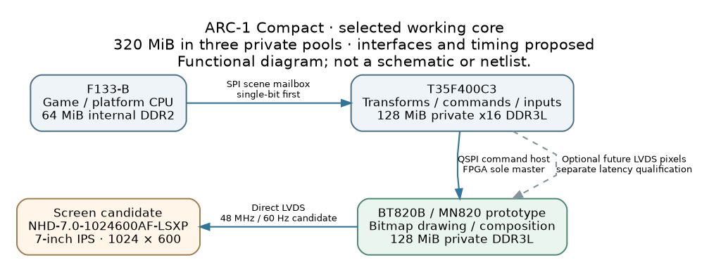

## What is ready

**R05 adds executable engineering work to the selected F133-B + T35F400C3 +
BT820B design.** It includes a C transport/session library, a portable fixed-point
transform/culling reference, corresponding SystemVerilog RTL with actual simulation,
a host integration model, display/memory validators and a manufacturer-source
T35 package inventory. Claude can build from these artifacts.

The selected combination remains a development direction. No assembled Compact,
bootable F133 image, complete FPGA design or rendered game was tested. The immediate
goal is a real CPU→FPGA→BT820→screen path, followed by measured workload qualification.

## Selected hardware

| Function | Selected part / working implementation | Memory target |
|---|---|---|
| Game/platform CPU | Allwinner F133-B | 64 MiB internal DDR2 |
| FPGA compute and command host | Efinix T35F400C3 | 128 MiB private x16 DDR3L; exact SKU open |
| Graphics/composition | Bridgetek BT820B; MN820 module first | 128 MiB private DDR3L on MN820 |
| Built-in screen candidate | Newhaven NHD-7.0-1024600AF-LSXP Rev2C | 7-inch IPS, 1024 × 600, single-channel LVDS |

**320 MiB is the selected total across three private pools**, not shared RAM or a
measured installed capacity. The screen is an accepted qualification candidate.
Storage, orientation, supporting power/audio/input circuits and final pins remain open.

F133 is the proposed SPI0 master of a scene mailbox. T35 performs useful work and
is the **sole BT820 QSPI host**. BT820 drives the display directly. FPGA LVDS pixels
into BT820 remain optional future work; decide physical routing/resource reservation
before PCB freeze. Initial CPU SPI is single-bit; quad is a separate qualification.

## Actual implementations and verification

| Area | Implemented / checked in R05 | Evidence limit |
|---|---|---|
| Transport | C11 codec, CRC32, bounded stream parser, epoch/sequence/credit session, retry/conflict handling; independent Python codec and 38 golden vectors | Host reference; no SPI PHY, DMA, IRQ or FPGA parser |
| Numeric kernel | Portable checked C11 fixed-point affine bounds/culling plus ready/valid SystemVerilog datapath | Host tests and actual Icarus simulation; no Efinity synthesis/STA |
| Integration | C codec/session + C compute library joined through explicit little-endian scene payloads; duplicate result replay/cache-loss handling | Synchronous host model; no RTL transport or BT drawing |
| Screen | Executable clock/raster/range checks; corrected porch interpretation and conditional BT register model | Planning arithmetic; no register writes or physical confirmation |
| BT memory | Aligned half-open allocations, overlap/reservation/capacity checks | Illustrative allowances; no workload asset inventory or DDR measurement |
| T35 package | 400 unique manufacturer ball records; all source fields independently compared | Zero PCB nets assigned; not a simultaneous interface fit |

The numeric suite contains **1,165 oracle cases**. C scalar and batch results and
the RTL match the independent reference. Simulation also checks backpressure,
simultaneous retire/accept, and reset during computation and while holding a result.
The reported 13,465 simulation cycles are testbench cycles, not a hardware benchmark.

Protocol checks include native C behavior, 14 independent Python/differential suites,
20,000 deterministic malformed buffers, full eight-credit completion cases and
ASan/UBSan. LeakSanitizer was disabled because of the execution environment; the
library does not allocate heap memory. Display/memory suites contain 14/18 tests;
integration has 13. Run `VERIFY.md` and inspect retained logs and source hashes.

### Contracts to preserve

Transport frames have a 20-byte little-endian header, up to 4,096 payload bytes and
a trailing CRC32. JOBs are nonempty; current session depth is eight. HELLO establishes
an epoch; accepted jobs execute once within the retained session window. Completed
duplicates need a separately retained result. The host session is deliberately
conservative and consumes about 32 KiB for retained payloads; choose an explicit
FPGA memory implementation rather than assuming it is free.

Application payload v1 carries 1–85 rectangles per JOB: an 8-byte batch header and
48-byte records. Each result record is 24 bytes. The kernel transforms all four
corners, rounds once to Q16.16 with ties away from zero, saturates, and performs a
conservative viewport intersection. Results are forward bounds, not BT820 inverse
sampling coefficients. `compute/CONTRACT.md`, `protocol/WIRE_ABI.md` and
`integration/SCENE_PAYLOAD_V1.md` define exact behavior.

### Synthetic integration result

The deterministic host scene processes 256 objects, including 64 quarter-turn
transforms: **218 visible and 38 culled**. Four batches contain 85/85/85/1 objects.
Its steady traffic is 12,416 request bytes plus 6,528 response bytes per scene,
including status/result framing. At 60 scenes/s this calculates to 1.13664 MB/s,
or 6.315 ms of serialized bits at 24 MHz single-bit SPI before gaps, scheduling,
DMA/HAL and asset transfers. HELLO and retries are excluded from this estimate.

This result proves the host contracts agree on a bounds workload. It draws no
pixels, implements no parallax scene and establishes no measured frame rate or
offload speedup. Measure CPU-only versus offloaded execution including all transfer
and wait time; this small kernel may not justify offload on its own.

## Display correction from R04

The nominal calculation remains **48,000,000 / (1280 × 625) = 60 Hz**. The clock
proposal is 38.4 MHz × 15 / (2 × 6). However, the panel table's typical totals imply
that its printed back interval **includes the sync pulse**. R04 treated that field
as an additional post-sync back porch. R05 corrects this planning interpretation:

| Interval | Horizontal clocks | Vertical lines |
|---|---:|---:|
| Active | 1024 | 600 |
| Sync | 16 | 1 |
| Back interval including sync | 160 | 23 |
| Equivalent post-sync back porch | 144 | 22 |
| Front porch | 96 | 2 |
| Total | 1280 | 625 |

The conditional front-first BT model gives HSIZE/HCYCLE/HSYNC0/HSYNC1/HOFFSET =
1024/1280/96/112/256 and VSIZE/VCYCLE/VSYNC0/VSYNC1/VOFFSET =
600/625/2/3/25. SO_MODE candidate is 0. **These are model outputs, not an
initialization sequence.** Confirm the panel interval interpretation and actual
BT82X encoding/firmware before writing them to hardware. R04's old values are
retained only as an intentionally failing regression fixture.

Lane/bit mapping, polarity, cable orientation, differential/common-mode levels,
termination and reset/power sequencing still need confirmation. Panel logic is
3.3 V; its backlight requires a constant-current design (documented nominal
150 mA around 19.2 V), not a direct GPIO supply. Documented typical/maximum
Tr+Tf is 30/40 ms; nominal 60 Hz does not guarantee acceptable motion response.
Use color-bit patterns, unique frame IDs and input-to-photon measurements.

## Memory and package progress

The BT allocator model reserves the upper 2.5 MiB of physical 128 MiB. Two RGB8
1024 × 600 buffers require 1,843,200 bytes each. Illustrative allowances add
32 MiB atlas storage, 8 MiB scratch, 4 MiB staging and 1 MiB saved lists. The model
allocates **48.515625 MiB**, leaving **76.984375 MiB** after the reservation.
These are planning allowances. Optional video capture is not allocated; actual
assets, swapchain requirements and concurrent bandwidth remain to be established.

The T35F400 package CSV comes from the official Efinix workbook, with its raw
source hash recorded. An independent openpyxl comparison checked every A–H field
against the standard-library extractor. All 400 balls are unique and all board-net
fields are blank. The 230 GPIO-named, 54 DDR-annotated, 138 DDIO and 92 LVDS-annotated
entries overlap; they cannot be summed or used as an available-pin budget.

Select the exact FPGA 1-Gbit x16 DDR3L part, then generate native T35F400C3 Efinity
DDR/pin/bank/clock/resource/STA evidence for all simultaneous interfaces. No such
native run occurred here. The workbook, Efinity installer/IP and downloaded HDL
tool binaries are not redistributed in this archive.

## Next work for Claude

1. Reproduce `VERIFY.md`, confirm source versions and preserve the tested contracts.
   Resolve any actual failure before building on the reference implementation.
2. Pin the F133 BSP/toolchain and implement a bootable SD0 prototype plus actual
   SPI0 HAL. Check PC2–PC7, PC4/PC5 boot straps, high impedance, persistent IRQ/status
   acknowledgment and recovery with invalid FPGA user logic.
3. Implement FPGA SPI mailbox and bounded asynchronous queues/result retention;
   integrate the existing kernel. Implement FPGA QSPI ownership and BT820 startup,
   command/asset uploads and readback using pinned official driver sources.
4. Select exact FPGA DDR and create the full-interface Efinity design. Retain actual
   constraints, IP/tool versions, warnings, resources, timing and loadable image.
   Allocate optional future video resources before PCB freeze.
5. Draw a real deterministic BT scene with transforms, transparency, parallax and
   telemetry. Qualify the panel electrically, visually and under concurrent load.
   Recover the authoritative game source/trace before claiming STRUTHIO fidelity.
6. Bench-test full-address memory, power/reset/recovery, unique-frame cadence and
   input latency. Compare complete CPU-only/offloaded paths; record a 30-minute
   representative 60 Hz challenge without confusing refresh with unique frames.

Work that needs unavailable hardware or Efinity stays explicitly unexecuted;
independent source/firmware/test work can continue. Exact storage, orientation,
audio/inputs/power and procurement are still engineering decisions. No Compact
schematic/netlist or fabrication release is included.

## Provenance and reading map

Root `CLAUDE.md` governs current Compact work. `engineering/tasks.json` records
partial progress and gaps; `sources.json` records manufacturer references, including
the new LVDS integration note and exact-package workbook source. Component logs
and `verification/last_run/summary.json` retain actual command results. See
`COVERAGE_AND_EVIDENCE.md` for evidence boundaries and `VERIFY.md` to reproduce.

The five supplied original attachments remain byte-identical under `reference/`.
R04 and older recommendations remain historical; the separate dual-T120 Tabletop
project is unchanged. Other chats, including the supplied chat identifier, were
not accessible. Missing historical/game artifacts are still missing. The package
contains no claimed review of unavailable conversation contents.
